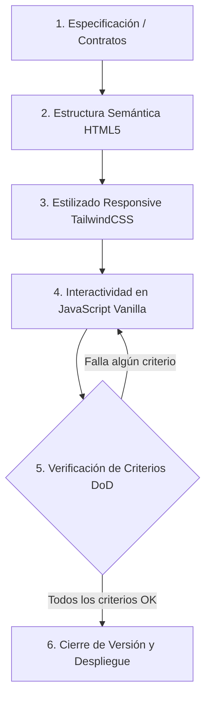

# Flujo de Trabajo y Definition of Done - SaludBarrial

Este documento detalla el ciclo metodológico de desarrollo (basado en el estándar SDD adaptativo de Gentle-AI) y la lista de control de calidad definitiva (Definition of Done) para dar por aprobado el proyecto.

---

## 1. Ciclo Metodológico de Desarrollo (SDD Adaptativo)

### Paso 1: Estructura y Semántica HTML5
- Redacción del esqueleto base en `index.html`.
- Declaración rigurosa de etiquetas semánticas (`<header>`, `<nav>`, `<main>`, `<section>`, `<article>`, `<aside>`, `<footer>`).
- Inclusión de metadatos de viewport (`<meta name="viewport" content="width=device-width, initial-scale=1.0">`), título descriptivo y carga de fuentes de Google Fonts ('Inter' / 'Poppins').

### Paso 2: Estilizado Responsive y Modo Oscuro con TailwindCSS
- Configuración de TailwindCSS v3 mediante CDN con soporte para clase `dark` en la raíz `<html>`.
- Aplicación de diseño **Mobile-First**: maquetar inicialmente para 360px de ancho y escalar con prefijos `md:` y `lg:`.
- Configuración de la paleta oficial (Azul cielo `#0284c7`, Verde esmeralda `#10b981`, Rojo emergencia `#dc2626`).
- Implementación de la barra flotante inferior (*Sticky Bottom Bar*) visible únicamente en teléfonos.

### Paso 3: Lógica Interactiva con JavaScript Vanilla
- Creación de la colección de datos de muestra en memoria (6 centros de salud con sus médicos y matrículas).
- Algoritmo de renderizado reactivo del DOM con innerHTML seguro y plantillas de tarjetas.
- Algoritmo de filtrado reactivo en tiempo real escuchando eventos `input` y `change` en los controles.
- Lógica de apertura y cierre de ventanas modales con soporte para tecla `Escape` y clic fuera del diálogo.
- Controlador del conmutador de tema Claro/Oscuro con persistencia en `localStorage`.

### Paso 4: Auditoría de Calidad y Cierre
- Ejecución del checklist de verificación técnica antes de la entrega final.

---

## 2. Definition of Done (DoD) - Lista de Control Obligatoria

Ningún componente o pantalla se considera terminado hasta cumplir el 100% de esta lista:

- [ ] **Semántica HTML5**: Sin etiquetas `
` huérfanas como botones; uso estricto de `<button>` y `<a>`.
- [ ] **Diseño Responsive (F12)**:
  - Celular pequeño (360px a 390px): 1 columna, botones anchos, menú colapsado y botón SOS fijado abajo.
  - Celular estándar (390px a 414px): Verificación de márgenes táctiles cómodos.
  - Tablet (768px): Grilla en 2 columnas.
  - Desktop (1024px o más): Grilla en 3 columnas y menú expandido.
- [ ] **Cero Scroll Horizontal Roto**: Verificado que ningún elemento desborde el ancho de la pantalla y contenedor blindado con `overflow-x-hidden`.
- [ ] **Consola Limpia**: Cero errores en color rojo ni advertencias no resueltas en las DevTools del navegador.
- [ ] **Verificación Visual de los 4 Estados UI**:
  - ⏳ **Loading**: Estado de preparación visual fluido durante la carga de recursos.
  - 📭 **Empty**: Mensaje amigable cuando los filtros no coinciden con ningún centro ("No se encontraron resultados"), con botón para restablecer filtros.
  - ❌ **Error**: Mensaje descriptivo si ocurre algún fallo en formularios o enlaces.
  - ✅ **Success**: Visualización fluida de tarjetas, badges de disponibilidad y confirmación tras interactuar.
- [ ] **Marcado Telefónico Operativo**: Todos los teléfonos importantes (`107`, `0800 444 5454`, `358 428 3673`) configurados con prefijo `tel:`.
- [ ] **Persistencia de Preferencia de Color**: La selección de modo claro u oscuro permanece intacta al recargar la página.
