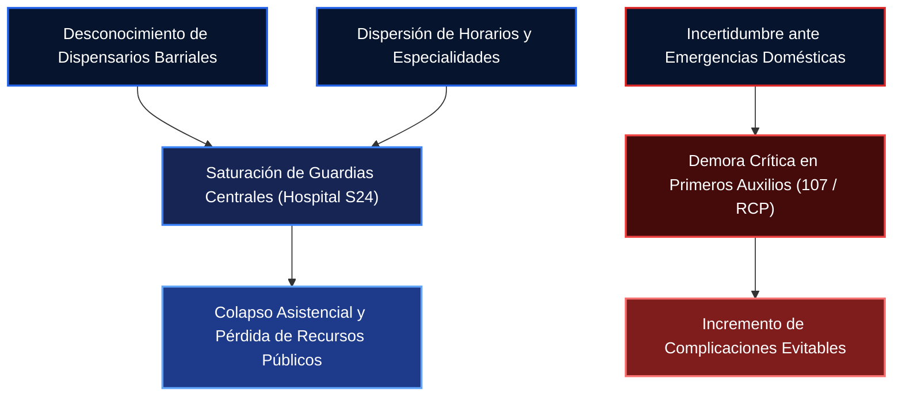

# Estudio de Mercado: SaludBarrial
## Plataforma Comunitaria de Acceso y Orientación a la Salud Primaria en Río Cuarto

---

### Resumen Ejecutivo
**SaludBarrial** es una iniciativa socio-tecnológica impulsada por la entidad sin fines de lucro **SaludPrimero**, concebida como respuesta directa a los desafíos de accesibilidad, dispersión informativa y saturación asistencial que experimenta el sistema de salud en la ciudad de **Río Cuarto, Provincia de Córdoba**.

El proyecto materializa una interfaz digital inclusiva, ágil y de cero fricción que articula el mapa de dispensarios y centros de atención barriales, el directorio de profesionales matriculados del Colegio de Médicos de Córdoba (Delegación Río Cuarto), un sistema de asistencia inmediata de triaje ante emergencias (Línea 107 y maniobras críticas) y canales de ayuda comunitaria directa.

---

### Misión, Visión y Valores Fundacionales

| Dimensión | Definición Estratégica |
| :--- | :--- |
| **Misión** | Empoderar al ciudadano de Río Cuarto mediante información de salud verificada, geolocalizada e inmediata, reduciendo la brecha de acceso y optimizando la demanda hospitalaria. |
| **Visión** | Consolidarse como la infraestructura de cabecera de salud ciudadana en el sur de Córdoba, donde cada vecino encuentre atención primaria a menos de 15 minutos de su hogar. |
| **Valores** | Accesibilidad universal (inclusión digital), transparencia pública, rigor profesional y solidaridad barrial. |

---

### Indicadores Clave del Problema (Río Cuarto)

---

### Estructura del Estudio de Mercado
El presente análisis se divide en 4 documentos técnicos complementarios:
1. **[01_resumen_ejecutivo.md](file:///c:/Users/pomil/Desktop/ALL/ITEC/segundo/Diseño%20Web/EFI/docs/estudio-de-mercado/01_resumen_ejecutivo.md)**: Síntesis de la propuesta de valor y visión general.
2. **[02_problematica_local.md](file:///c:/Users/pomil/Desktop/ALL/ITEC/segundo/Diseño%20Web/EFI/docs/estudio-de-mercado/02_problematica_local.md)**: Radiografía sociosanitaria de Río Cuarto y fricciones barriales.
3. **[03_analisis_mercado.md](file:///c:/Users/pomil/Desktop/ALL/ITEC/segundo/Diseño%20Web/EFI/docs/estudio-de-mercado/03_analisis_mercado.md)**: Benchmark de soluciones existentes, mapa de actores y matriz FODA.
4. **[04_impacto_y_solucion.md](file:///c:/Users/pomil/Desktop/ALL/ITEC/segundo/Diseño%20Web/EFI/docs/estudio-de-mercado/04_impacto_y_solucion.md)**: Validación del producto, métricas clave de éxito y modelo de sostenibilidad.
