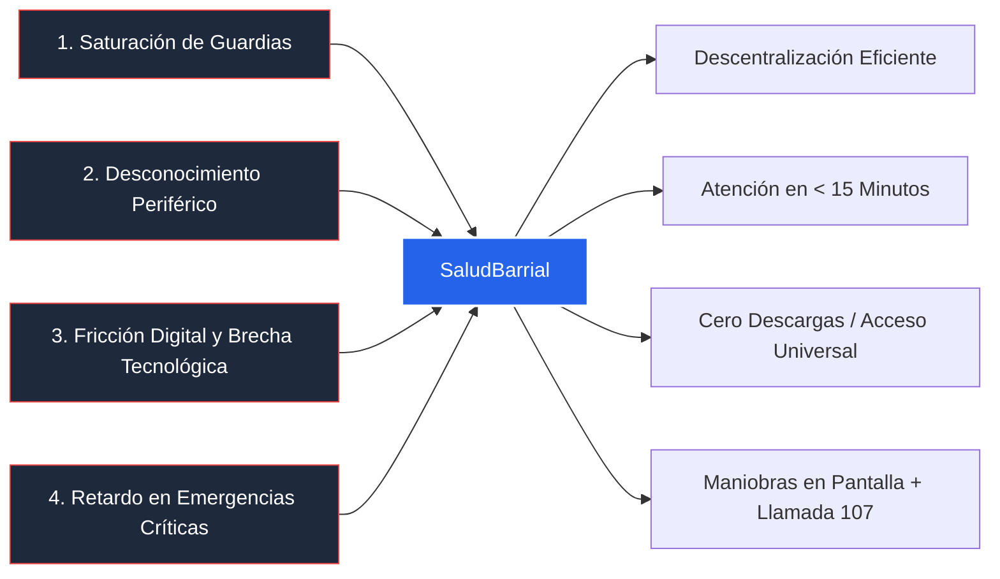

# Estudio de Mercado: Problemática Sociosanitaria en Río Cuarto
## Diagnóstico Barrial, Fricciones de Acceso y Análisis de Demanda

---

### 1. Contexto Sociodemográfico de Río Cuarto
Río Cuarto es el segundo conglomerado urbano más poblado de la provincia de Córdoba, con una población superior a los **180.000 habitantes** (censo proyectado). La ciudad presenta una marcada segmentación geográfica y barrial:
- **Sector Banda Norte**: Área de rápida expansión residencial, con alta proporción de familias jóvenes y niños.
- **Sector Alberdi**: Zona tradicional de alta densidad demográfica, con sectores de vulnerabilidad económica y adultos mayores con movilidad reducida.
- **Sector Villa Dalcar / Oeste**: Zona residencial con centros de atención primaria distantes de las arterias hospitalarias principales.
- **Sector Centro**: Concentración de servicios administrativos, policonsultorios privados y farmacias de turno, pero distante del acceso peatonal barrial.

---

### 2. Los 4 Nodos Críticos de la Problemática Sanitaria

#### Nodo 1: Sobredemanda Innecesaria en Guardias Centrales
- **Evidencia**: Entre un **60% y un 70%** de las consultas que ingresan a las guardias de alta complejidad (Hospital San Antonio de Padua / Hospital S24) corresponden a patologías de **Nivel de Complejidad Leve (Triage Verde / Azul)**: fiebre pediátrica leve, recetas, certificados, esguinces menores o vacunas de calendario.
- **Causa Raíz**: El vecino no sabe con certeza si su dispensario barrial (Dispensario Alberdi, Banda Norte N°3 o Villa Dalcar) cuenta con médico en ese horario o si dispone de vacunas. Ante la duda, asume el costo de traslado hacia la guardia central, generando colas de espera de 3 a 5 horas.

#### Nodo 2: Dispersión e Inconsistencia de la Información
- Los horarios de atención médica en el primer nivel suelen publicarse en carteleras físicas de papel o en comunicados de prensa desactualizados en redes sociales.
- La búsqueda en Google Maps arroja con frecuencia fichas no reclamadas, números de conmutadores generales desconectados o direcciones erróneas sin indicación de si la atención es gratuita o requiere obra social.

#### Nodo 3: La Barrera de las Apps Móviles Complejas
- La mayoría de las soluciones de telemedicina o portales gubernamentales exigen:
  1. Descarga obligatoria de aplicaciones pesadas desde Google Play o App Store (>80 MB).
  2. Creación de cuenta, contraseñas, confirmación de correo o validación biométrica con DNI.
  3. Consumo intensivo de datos móviles en conexiones 3G/4G inestables.
- Para un adulto mayor o una persona en situación de urgencia con un familiar enfermo, esta fricción técnica deriva en el abandono inmediato de la herramienta.

#### Nodo 4: Vacío de Actuación en los Primeros 5 Minutos de Emergencia
- Frente a un paro cardiorrespiratorio, una asfixia por cuerpo extraño (atragantamiento) o una hemorragia aguda, el tiempo hasta la llegada del servicio de ambulancia (Línea 107) promedia entre 8 y 15 minutos en zonas periféricas.
- La ausencia de una guía visual instantánea en el bolsillo del ciudadano impide que los testigos presenciales inicien maniobras salvadoras de RCP o Heimlich de inmediato.
