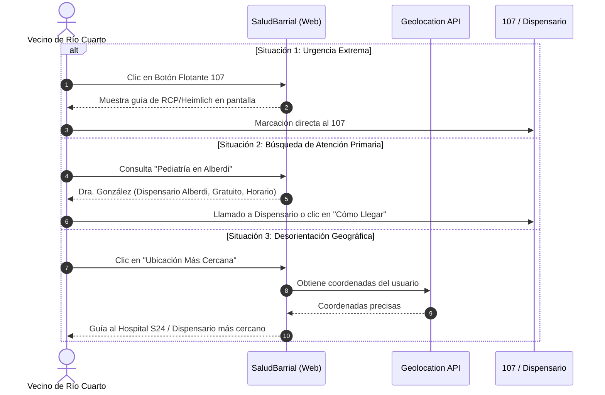

# Estudio de Mercado: Impacto Social, Validación y Solución
## Modelo de Intervención, Métricas de Éxito y Sostenibilidad

---

### 1. La Solución Integral: SaludBarrial

SaludBarrial interviene en la cadena de atención sanitaria ciudadana en tres momentos clave:

---

### 2. Cuantificación del Impacto Estimado

1. **Reducción del Tiempo de Toma de Decisión**:
   - *Antes*: 25 a 40 minutos preguntando en grupos de WhatsApp barriales o navegando portales lentos.
   - *Con SaludBarrial*: **Menos de 60 segundos** para hallar el centro, horario y número de teléfono.

2. **Descompresión de Guardias Hospitalarias**:
   - Canalización de un **20% a 30%** de consultas de baja complejidad hacia dispensarios barriales, ahorrando costos operativos y reduciendo el tiempo de espera de casos graves.

3. **Democratización de Primeros Auxilios**:
   - Disponibilidad permanente de los 4 protocolos de emergencia más frecuentes (RCP, Obstrucción de vía aérea por asfixia, Hemorragias y Desmayos) sin necesidad de descargar manuales en PDF.

---

### 3. Métricas de Éxito (KPIs de Producto)

| KPI | Objetivo Inicial | Medición Técnica |
| :--- | :--- | :--- |
| **Tiempo de Carga Inicial (LCP)** | < 1.2 segundos en red 4G/3G | Lighthouse Performance Score ≥ 95 |
| **Clicks a Marcación Telefónica (`tel:`)** | Ratio > 15% sobre visitas totales | Eventos de intención de contacto |
| **Consultas de Directorio con Éxito** | > 85% de búsquedas con resultados | Filtros reactivos sin página vacía |
| **Interacciones con Asistente de Triaje** | Acceso en 1 solo clic | Modal flotante FAB con apertura < 100ms |

---

### 4. Modelo de Sostenibilidad y Donaciones
Para preservar su carácter libre, gratuito e independiente de intereses partidarios, **SaludBarrial** adopta un modelo transparente de economía comunitaria:
- **Módulo de Donaciones Oficiales**: Datos bancarios directos (CBU / Alias) para aportes solidarios destinados a insumos de primeros auxilios barriales.
- **Espacios de Patrocinio Ético**: Banners no invasivos destinados a comercios locales de confianza (computación, servicios automotores) que financian la infraestructura tecnológica sin recopilar datos personales de los vecinos.
- **Transparencia Absoluta**: Cero almacenamiento de historiales médicos ni comercialización de datos personales.
